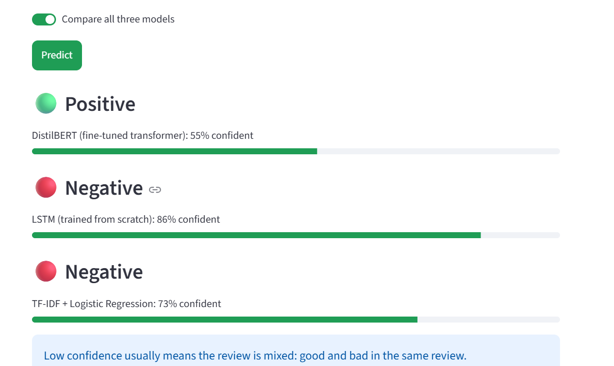
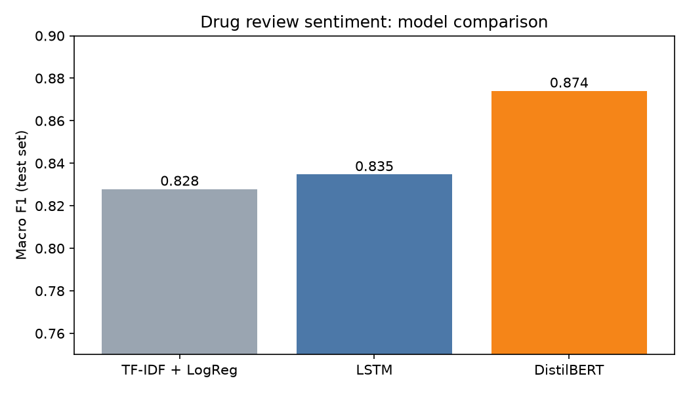

# Drug Review Sentiment Classifier

**Predicts whether a patient was satisfied with a medication from the text of their review,
and compares three approaches: a classic baseline, a neural network built from scratch, and a fine-tuned transformer.**

**[▶ Try the live demo](https://drug-review-sentiment.streamlit.app/)** · [Models on Hugging Face](https://huggingface.co/temiloluwadeboye/drug-review-sentiment-models)



## Results

Scored once on 22,630 held-out test reviews that no model saw during training or tuning.

| Model | Accuracy | Macro F1 | Negative reviews caught |
|---|---|---|---|
| Always guess "positive" (dummy) | 0.629 | 0.386 | 0% |
| TF-IDF + Logistic Regression | 0.843 | 0.828 | 73.4% |
| LSTM, trained from scratch in PyTorch | 0.847 | 0.835 | 77.1% |
| **DistilBERT, fine-tuned** | **0.884** | **0.874** | **82.2%** |



*Note: the chart's vertical axis starts at 0.75 so the differences are visible.*

**Main score: macro F1.** 63% of reviews are positive, so a model that always says "positive" is already
63% accurate while being useless. Macro F1 averages the scores for both classes, so a model can't
look good by ignoring negative reviews.

## Key findings

1. **Starting from a model that already understands English mattered most.** The LSTM, which had to learn
   language from these reviews alone, improved macro F1 by 0.007 over the baseline. Fine-tuning DistilBERT,
   which was pretrained on Wikipedia and books, improved it by 0.046, more than six times as much.
2. **DistilBERT fixed the baseline's main weakness.** The baseline missed about 1 in 4 negative reviews;
   DistilBERT misses fewer than 1 in 5.
3. **Better accuracy has a cost.** DistilBERT has 67 million weights (the LSTM has 2.6 million) and needs a GPU
   to train in reasonable time. Scoring the 22,630 test reviews took about an hour on a laptop CPU, against
   seconds for the baseline. For a high-volume system on a budget, the baseline would be a reasonable choice.
4. **Data leakage was caught early.** 37% of the raw rows were copies: Drugs.com lists the same review under
   both the brand-name and generic drug. Left in, copies would land in both training and test sets and inflate
   the scores. All duplicates were removed before splitting.

## What the best model still gets wrong

I read and tagged a random sample of 50 of DistilBERT's 2,635 test mistakes
([notebook](notebooks/error_analysis.ipynb), [tagged sample](results/error_analysis_sample.csv)):

| Reason | Count |
|---|---|
| Mixed review (benefits and side effects together) | 14 |
| Needs outside context to judge | 11 |
| Too short to judge | 7 |
| Review cut off mid-sentence in the dataset | 6 |
| Star rating disagrees with the text (label noise) | 5 |
| Clear review, model simply wrong | 5 |
| Scraping glitch / negation | 2 |

Only about 1 in 10 mistakes was the model getting a clear review wrong. Most came from reviews that are
genuinely ambiguous, or from limits of the data itself, such as cut-off reviews and ratings that disagree with what the patient wrote.

## How it works

1. **Clean the data** ([`src/prepare_data.py`](src/prepare_data.py)): remove duplicate reviews, drop usernames,
   label ratings 7–10 as positive and 1–4 as negative (5–6 left out as ambiguous), then split
   80/10/10 into train, validation and test sets, keeping the same positive/negative mix in each.
2. **Baseline** ([`src/baseline.py`](src/baseline.py)): TF-IDF on single words and word pairs (so "not good"
   counts as a unit), then logistic regression.
3. **LSTM** ([`src/lstm.py`](src/lstm.py)): word embeddings + an LSTM + a linear output layer, with a hand-written
   training loop, dropout, and early stopping on validation macro F1. Trained on a Colab GPU
   ([notebook](notebooks/train_lstm_colab.ipynb)).
4. **DistilBERT** ([`src/distilbert.py`](src/distilbert.py)): fine-tuned `distilbert-base-uncased` for 2 epochs
   with a small learning rate, a warmup schedule and mixed precision. Trained on a Colab GPU
   ([notebook](notebooks/train_distilbert_colab.ipynb)).
5. **Final test** ([`src/evaluate_test.py`](src/evaluate_test.py)): all three models scored once on the untouched test set.
6. **Serving**: a [FastAPI](app/api.py) endpoint and a [Streamlit](app/streamlit_app.py) web app, sharing one
   [prediction module](src/predict.py) that downloads the models from Hugging Face Hub when they aren't on the machine.

## Run it yourself

Requires Python 3.12.

```bash
git clone https://github.com/temiloluwadeboye/drug-review-sentiment.git
cd drug-review-sentiment
python -m venv .venv
.venv\Scripts\activate          # Windows (macOS/Linux: source .venv/bin/activate)
pip install -r requirements.txt
```

**Use the trained models** (downloaded from Hugging Face automatically on first use):

```bash
streamlit run app/streamlit_app.py      # web app
uvicorn app.api:app --reload            # API; open http://127.0.0.1:8000/docs
```

```bash
curl -X POST http://127.0.0.1:8000/predict -H "Content-Type: application/json" \
     -d '{"text": "It helped my migraines a lot", "model": "distilbert"}'
# {"model":"distilbert","label":"positive","confidence":0.983}
```

**Retrain from scratch:** download the dataset (link below) to `data/raw/DrugReviews.csv`, then:

```bash
python -m src.prepare_data
python -m src.baseline
python -m src.lstm              # a GPU is recommended; see notebooks/ for Colab
python -m src.distilbert        # needs a GPU; see notebooks/ for Colab
python -m src.evaluate_test
pytest                          # 13 tests: data cleaning and the API
```

## Project structure

```
├── app/              Streamlit web app and FastAPI endpoint
├── data/             raw and processed data (not in git)
├── deploy/           Dockerfile to run the app in a container
├── docs/images/      screenshots
├── models/           trained models (not in git; hosted on Hugging Face)
├── notebooks/        Colab training notebooks and error analysis
├── results/          scores, comparison chart, tagged error sample
├── scripts/          upload models to Hugging Face
├── src/              data cleaning, the three models, evaluation, prediction
└── tests/            pytest tests
```

## Data

**DrugRev: A comprehensive customers reviews on drugs purchasing and satisfaction** (Mendeley Data, version 1, 2023)

- Dataset page: https://data.mendeley.com/datasets/64cc5w5dxy/1
- DOI: [10.17632/64cc5w5dxy.1](https://doi.org/10.17632/64cc5w5dxy.1)
- Direct download (`DrugReviews.csv`, ~170 MB): https://data.mendeley.com/public-files/datasets/64cc5w5dxy/files/288e24c1-4605-4c4b-9a88-c789f94dbe35/file_downloaded
- License: [Creative Commons Attribution 4.0 (CC BY 4.0)](https://creativecommons.org/licenses/by/4.0/)

392,510 patient reviews from Drugs.com. **Changes made:** duplicates and usernames removed, ratings converted
to positive/negative labels, neutral ratings (5–6) excluded, leaving 226,291 reviews.

**Citation:**
Ahmed, T., Mia, M. M., Mazrur, M. B., Rana, M. S., Ekfa, R. I., & Rahman, W. (2023). *DrugRev: A comprehensive customers reviews on drugs purchasing and satisfaction* (Version 1) [Data set]. Mendeley Data. https://doi.org/10.17632/64cc5w5dxy.1

This project is not affiliated with or endorsed by the dataset authors or Drugs.com.
**For demonstration only. Not medical advice.**

## License

Code: [MIT](LICENSE). Data: CC BY 4.0, as above.
